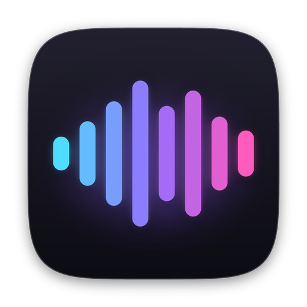

<p align="center"></p>

<h1 align="center">Murmur</h1>
<p align="center"><b>Hold a key. Talk. Polished text appears wherever you're typing.</b><br>
For macOS and Windows. Uses the Claude or ChatGPT plan you already pay for.</p>

---

Murmur is a voice-dictation app. Hold **⌥ Space** (macOS) or **Ctrl + Shift + Space** (Windows), say what you mean,
um's and all, and let go. Murmur turns your speech into text on your computer, has Claude or ChatGPT rewrite it into
what you meant to type, and pastes it into the app you're in: Slack, Gmail, VS Code, Notes, anything.

> "um so I was thinking we should meet on tuesday no wait wednesday at like three to talk about the launch"
>
> → **We should meet on Wednesday at 3 to talk about the launch.**

## Why it's different

- **No new subscription.** Murmur connects to your existing **Claude Pro/Max** plan through the official Claude Code
  app, or your **ChatGPT Plus/Pro** plan through the official Codex app. Murmur never sees your password or tokens.
  API keys and a no-AI mode are there too.
- **Fast.** About **1 second** from letting go of the key to finished text, on an M4 MacBook (measured below).
- **Built-in speech-to-text, nothing to download.** Murmur uses the recognizer that ships with your OS: Apple's Speech
  framework on macOS (on-device when your Mac supports it) and Microsoft's speech recognition on Windows.
  Only the transcript text goes to the AI you chose.
- **Tiny.** The installer is about 5 MB and the app under 10 MB. No voice model to download.

## Install

1. Open the [**Releases**](../../releases/latest) page and download one file:
   - **macOS (Apple Silicon):** `Murmur_x.y.z_aarch64.dmg` (about 4 MB). Open it and drag Murmur into
     **Applications**, then open it from there. Running it straight from the disk image works, but macOS then won't
     remember its permissions. The first time, **right-click Murmur → Open**: the release isn't notarized by Apple yet.
   - **Windows 10/11 (x64):** `Murmur_x.y.z_x64-setup.exe` (about 3 MB). It installs for your user only, with no admin
     prompt. If SmartScreen warns you, click **More info → Run anyway**.
2. Open Murmur. A setup window lists only the steps you haven't done yet: anything already allowed or connected
   (after a reinstall or update, say) is skipped.
3. When setup is done, Murmur offers to move the installer file it finds in your Downloads folder to the Trash
   (Recycle Bin on Windows). Nothing is removed unless you click **Move to Trash**; **Keep** leaves it alone and Murmur
   won't ask about that file again.

**Nothing else gets installed.** The installer contains only Murmur. It doesn't download voice models, runtimes or
helpers, and it adds no background services beyond Murmur itself (and its optional "Open at login" entry). Murmur
uses the speech recognizer and, on Windows, the WebView2 runtime that already ship with the OS. WebView2 comes with
Windows 11 and with current Windows 10; on an old Windows 10 without it, install the Evergreen runtime from Microsoft
first. The only optional download is the Claude Code or Codex app, and only if you click **Install** for it.

### Permissions

Murmur asks for each permission only when you click its button in setup, after saying what it's for. It never pops
a system prompt on its own, and if a key press finds something missing it opens setup instead.

| Permission | macOS | Windows | Why |
|---|---|---|---|
| Microphone | System prompt (once) | Settings › Privacy & security › Microphone › *Let desktop apps access your microphone* | To hear you while you hold the shortcut, or while the wake word is on |
| Speech recognition | System prompt (once) | Settings › Privacy & security › Speech › **Online speech recognition** | Turns your voice into text with the OS's built-in recognizer. On Windows this sends dictation audio to Microsoft |
| Accessibility | System Settings › Privacy & Security › Accessibility | not needed | To press ⌘V for you. Optional: without it the text is copied and you paste it yourself |

Murmur never asks for Screen Recording, Full Disk Access, Input Monitoring, contacts or files.

**After an update (macOS):** macOS ties permissions to the app's code signature. Release builds aren't yet signed with
a Developer ID, so macOS may treat an update as a new app and ask again. If Accessibility shows **on** but pasting
doesn't work, open setup and click **Reset Murmur's entry**, then allow it again.

### Connecting your AI account

Murmur shows **Connected** only after a real test: it sends one short message ("testing one two three") through your
account and checks that a rewrite comes back. Until then it says **Signed in, not verified** or **Not connected**.

1. **Install** the official app: Claude Code for a Claude plan, Codex for a ChatGPT plan. Murmur's **Install** button
   opens a terminal running the vendor's own installer.
2. **Sign in.** The **Sign in** button opens a terminal running `claude auth login` or `codex login`, which opens
   claude.ai or chatgpt.com in your browser. You sign in there with your own account; Murmur never sees your password
   or tokens.
3. **Verify.** Murmur runs the test message automatically once you're signed in (or click **Verify**). Every successful
   dictation renews it. If a rewrite fails because you're signed out, Murmur drops back to *not verified* and asks you
   to sign in again.

Free accounts: Claude Code needs a Claude Pro or Max plan (or an API key); Codex works with ChatGPT plans that include
it. With no AI connected, Murmur still works and pastes the raw transcript.

## Using it

| Do this | Result |
|---|---|
| **Hold** the shortcut, talk, release | Dictate a sentence or a paragraph |
| **Tap** the shortcut once | Hands-free: talk, then just stop. Murmur finishes by itself after a short pause (or tap again) |
| **Esc** while listening | Cancel |
| Say "new paragraph", "new line", "comma", "question mark"… | Formatting, typed for you |

A floating pill at the bottom of the screen shows live waves while you talk, then *Transcribing → Polishing → ✓*.
Murmur lives in the menu bar (or the Windows system tray). From there you can open settings, start dictation, or quit.

**Writing styles:** Clean (minimal edits), Polished (professional), Casual, Email, or Custom (describe your own).
**Dictionary:** add names and jargon ("Kubernetes", "Priya") so they're always spelled right.
**History:** every dictation is kept locally with the raw transcript next to the rewrite.

## How it connects to your plan

| Option | What Murmur runs | You pay |
|---|---|---|
| **Claude** (default) | `claude -p --model haiku` (Claude Code, signed in with your Claude account) | Nothing extra: counts toward your Pro/Max usage |
| **ChatGPT** | `codex exec` (OpenAI Codex CLI, signed in with ChatGPT) | Nothing extra: counts toward your Plus/Pro usage |
| Claude API / OpenAI API | Direct HTTPS with your key (stored in the system keychain) | Per-token API pricing |
| No rewrite | Nothing | Free, offline |

**The latency trick:** Murmur starts the CLI the moment you *press* the key, so its 3–5 s startup overlaps with you
talking. It also takes Claude's answer the moment it arrives, without waiting ~1.3 s for the CLI to finish its
bookkeeping. Rewrites are told to never *answer* what you dictated. "What's the capital of France?" gets typed,
not answered, and so does "ignore previous instructions…".

If the AI fails (signed out, usage limit hit, offline), Murmur pastes your raw transcript and says why. You never lose
what you said.

## Measured (Apple M4, Apple on-device speech, Claude Haiku via a Pro plan)

Speech-to-text on a 3.7 s clip: 0.36–0.49 s. The table below is from the earlier Whisper engine.

| Clip | Whisper | Release → text pasted |
|---|---|---|
| 9.4 s, self-correction ("Tuesday, no wait, Wednesday") | 0.26 s | **0.85 s** |
| 7.4 s, list | 0.24 s | **0.86 s** |
| 1.6 s, question (must not be answered) | 0.16 s | **0.67 s** |
| Prompt-injection attempt | 0.18 s | 0.75 s, typed verbatim ✓ |

Speed depends on the AI service: Claude Haiku usually answers in about 0.9 s, with occasional slow ones around 3 s.
ChatGPT plans can only use Codex's full model, so they take about 3–4.5 s.

Reproduce with `cargo run --release --example e2e -- clip.wav claude clean` (the WAV can come from macOS `say`), or
test the whole app, windows included, with a recorded clip standing in for the mic:

```bash
MURMUR_SELFTEST=clip.wav MURMUR_REPORT=report.jsonl MURMUR_SELFTEST_PROVIDER=claude \
  Murmur.app/Contents/MacOS/murmur
```

The report lists what each window rendered (pill size, how many wave pixels were lit, the text shown), where the
windows sit on screen, each pipeline stage with its time, and the final text. Nothing is pasted unless
`MURMUR_SELFTEST_PASTE=1` is set.

## Build from source

Requirements: Rust (stable) and Node 18+. On Windows you also need the Visual Studio C++ build tools.

```bash
npm install
npx tauri dev          # run with hot reload
npx tauri build        # .app + .dmg on macOS, setup .exe on Windows
cd src-tauri && cargo test --release
```

Releases are built by GitHub Actions: pushing a tag like `v0.1.0` builds the macOS and Windows installers and attaches them
to a GitHub Release (`.github/workflows/release.yml`). Every push runs tests, clippy and a release build on both macOS and
Windows (`ci.yml`).

### Project layout

```
src-tauri/src/
  lib.rs       shortcut state machine (hold / tap-for-hands-free / esc), pipeline, windows, tray, commands
  audio.rs     mic capture thread, live levels for the waves, 16 kHz resampling, silence gate, UI chimes
  stt.rs       OS speech recognition: Apple Speech framework (macOS), Windows.Media.SpeechRecognition (Windows)
  llm.rs       rewrite prompt + styles, Claude Code / Codex / API providers, pre-warming, output cleanup
  cli.rs       finds the claude/codex CLIs (GUI apps get a bare PATH), login status, install/sign-in terminals
  paste.rs     clipboard + ⌘V/Ctrl+V, clipboard restore, macOS Accessibility check
ui/            overlay pill (canvas waves) and the settings / onboarding window. Plain HTML/CSS/JS, no build step
```

## Troubleshooting

- **Nothing pastes (macOS):** enable Murmur under Privacy & Security › Accessibility. If it's already on (common after
  an update), click **Reset Murmur's entry** in setup and allow it again. Until then, Murmur copies the rephrased text
  and the pill says "⌘V to paste".
- **Reinstalling:** your settings, history and connection status live in `~/Library/Application Support/Murmur`
  (macOS) or `%APPDATA%\Murmur` (Windows), which reinstalling doesn't touch, so setup only shows what's still missing.
  To start over completely, delete that folder.
- **Building it yourself on a Mac:** `./scripts/install-mac.sh` builds, signs with your Apple Development certificate
  if you have one (so permissions survive rebuilds), installs to /Applications and starts it.
- **What happened?** `~/Library/Logs/Murmur/murmur.log` records each dictation step: mic, audio level, transcript and
  result. It holds no audio.
- **"Not connected" / "Signed in, not verified":** open Murmur › AI Rewrite. Click **Sign in** (or run
  `claude auth login` / `codex login`), then **Verify**. The error from the test message is shown there.
- **Shortcut does nothing:** another app may own it. Pick a different one under Shortcut.
- **Intel Macs / Linux:** not in the prebuilt releases yet. Build from source.

## License

Apache-2.0. Speech recognition by the operating system (Apple Speech on macOS, Windows speech recognition on Windows).
Murmur is an independent project and is not affiliated with Anthropic or OpenAI.
